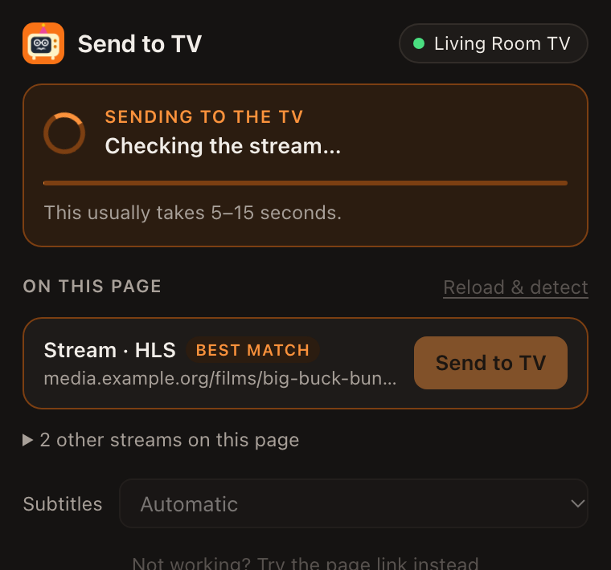
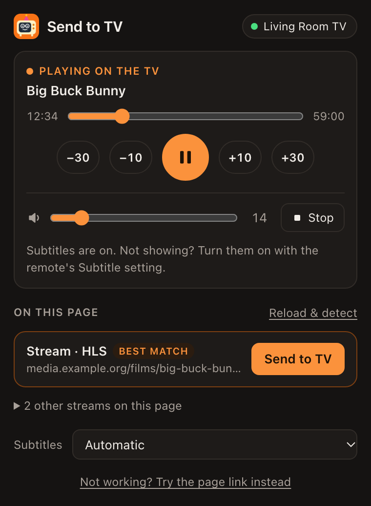

<p align="center"></p>

<h1 align="center">Send to TV</h1>

<p align="center"><em>Teach your old TV new tricks.</em></p>

<p align="center">
  <a href="https://github.com/AshkanTavassoli/send-to-tv/actions/workflows/ci.yml"></a>
  <a href="LICENSE"></a>
  
</p>

**Play the video from any web page on your TV — at full quality, with subtitles — from Chrome on your Mac.**

Smart-TV browsers (especially on older Samsung Tizen TVs) are slow and break on modern sites. Screen mirroring is choppy and low-res. *Send to TV* takes a different route:

1. A Chrome extension notices the video stream a page is playing (HLS `.m3u8`, DASH `.mpd`, or a plain `.mp4`), together with the cookies/referer the site expects, and any subtitle file.
2. A small helper on your Mac pulls that stream and **repackages it without re-encoding** (H.264/HEVC are passed straight through).
3. The TV is told over **DLNA/UPnP** to play it, so the **TV's own hardware video player** does the decoding — the same player it uses for its own apps. Smooth, full resolution.
4. You control playback from the extension popup or keyboard shortcuts on the Mac.

Nothing is installed on the TV. No Developer Mode, no rooting.

<p align="center">
  
  
</p>

```
 Chrome (Mac)                      Mac helper                        TV
 ┌──────────────┐  stream URL +   ┌──────────────────┐   DLNA "play  ┌─────────────────┐
 │ extension    │  headers, subs  │ ffmpeg remux →   │   this URL"   │ built-in media  │
 │ finds video  ├────────────────►│ MPEG-TS on LAN   ├──────────────►│ player (HW      │
 │ + controls   │  127.0.0.1:8770 │ subs → SRT       │◄──────────────┤ decode, subs)   │
 └──────────────┘                 └──────────────────┘  TV pulls     └─────────────────┘
```

## Features

- Detects HLS/DASH/MP4 streams on any page (including players inside iframes) and picks the best quality.
- Forwards the page's cookies, referer and user-agent, so streams that require them still play.
- **Subtitles on the TV**: WebVTT/SRT/ASS from the page or inside the HLS stream, converted to SRT and drawn by the TV itself (Samsung's `CaptionInfo` DLNA extension). Captures subtitle text as the page downloads it, so single-use / locked subtitle links still work.
- Separate audio tracks (HLS audio renditions, yt-dlp video+audio formats).
- **Seek with the TV remote**: the TV's own progress bar and arrow keys work. The helper offers the video to the TV as one big file of estimated size; when the TV asks for "bytes from N" it starts the stream at the matching time.
- Controls on the Mac: play/pause, ±10 s / ±30 s, seek bar, stop, TV volume, subtitle on/off/choice. Shortcuts: **⌥⇧P** play/pause, **⌥⇧→** +30 s, **⌥⇧←** −10 s.
- Shows what is happening while a video is being sent (checking the stream, preparing subtitles, starting the TV), so you always know whether it worked.
- Pauses the page's own player when the TV takes over.
- Fallback: **"Try the page link instead"** hands the page URL to [yt-dlp](https://github.com/yt-dlp/yt-dlp) (YouTube and ~1,800 known sites).
- Finds the TV automatically (SSDP) and remembers it; re-finds it if its IP changes.
- **Runs only when needed**: launchd starts the helper on the first request from the extension and it quits after 15 idle minutes. While streaming it keeps the Mac awake; otherwise not.
- VP9/AV1 streams (which older TVs can't decode) are re-encoded with the Mac's hardware H.264 encoder.

## Requirements

- macOS (tested on Apple Silicon), Google Chrome (or another Chromium browser).
- Python 3.8+ (`python3`; Homebrew's or Apple's), [ffmpeg](https://ffmpeg.org) — the installer can install it via [Homebrew](https://brew.sh). yt-dlp is optional.
- A TV with a DLNA/UPnP media renderer on the same network.

### Tested on

| TV | Year / OS | Video | Subtitles |
| --- | --- | --- | --- |
| Samsung UN50NU7400 | 2018, Tizen 4.0 | ✅ 1080p HLS/MP4 | ✅ |

Other Samsung Tizen TVs should behave the same. LG/Sony/other DLNA TVs should play video; subtitle support depends on the TV. **Please open an issue with your TV model and results** — that's the most useful contribution right now.

## Install

```bash
git clone https://github.com/AshkanTavassoli/send-to-tv.git
cd send-to-tv
./install.sh
```

The installer copies everything to `~/Applications/Send to TV`, registers the on-demand helper, looks for your TV, and opens the extension folder in Finder. Then, once:

1. Open `chrome://extensions` and turn on **Developer mode** (top right).
2. **Load unpacked** → choose `~/Applications/Send to TV/extension`.
3. Pin **Send to TV** to the toolbar.

> **macOS Local Network permission:** the first time, macOS may ask whether "Python" can find devices on your local network — click **Allow**. If the popup says the TV can't be reached, check System Settings → Privacy & Security → Local Network.

## Use

1. Turn the TV on.
2. Open the page in Chrome and press play on the video for a second (so the stream starts loading). Turn on subtitles in the page's player if you want them.
3. Click **Send to TV** → **Send to TV** on the top entry ("best guess").

If nothing is listed, press **Reload & detect**, play the video again, and reopen the popup.

If subtitles don't appear on a Samsung TV, open the remote's **Tools / Subtitle** setting while the video plays and turn them on.

## Configuration

Environment variables (set them in `~/Library/LaunchAgents/com.sendtotv.helper.plist` under `EnvironmentVariables`, then re-run `./install.sh` or reload the agent):

| Variable | Default | Meaning |
| --- | --- | --- |
| `TVCAST_TV` | *(auto)* | TV IP address, or part of its name if you have several TVs |
| `TVCAST_PORT` | `8770` | Local port (also change `HELPER` in the extension if you change it) |
| `TVCAST_SUB_LANGS` | `en,en-US,en-GB` | Preferred subtitle languages for streams with several |
| `TVCAST_IDLE_EXIT` | `900` | Seconds idle before the helper quits (`0` = never) |

Logs: `~/Library/Logs/SendToTV.log`. Remembered TV: `~/Library/Application Support/TVCast/config.json`.

## Limits

- **DRM-protected services (Netflix, Disney+, Prime Video, …) do not and will not work.** This tool does not bypass DRM; use the TV's own apps for those.
- Each jump takes the TV 2–4 seconds to resume. Live streams can't be seeked.
- Use the remote's **arrows or progress bar** to jump, not **⏩ fast-forward**: fast-forward asks for a new position every second, faster than a web stream can restart, and the TV freezes (a jump with the arrows/progress bar or the popup unfreezes it).
- Streams pass through the Mac, so it must stay on (it's kept awake automatically while streaming).
- Sites that bind stream URLs to a single browser connection may not work.

## Privacy and security

- **Nothing is sent to us or to any third party.** There is no account, no analytics and no server of ours. The extension talks only to the helper on your own Mac (`127.0.0.1`); the helper talks only to the video's own server and to your TV.
- **Why the extension can see every site:** it has to notice video and subtitle requests on whatever page you happen to be watching, and read the headers (cookies, referer) that request used so the helper can fetch the same stream. That information stays in memory for the browser session and is never written to disk.
- **The helper accepts commands only from the extension on the same Mac.** Requests from web pages are refused, and only `http(s)` addresses can be cast.
- The stream is offered to the TV on your local network while it plays, at an address with a random id. Use it on networks you trust.

Details and how to report a problem: [SECURITY.md](SECURITY.md).

## Uninstall

```bash
./uninstall.sh
```

Then remove the extension in `chrome://extensions`.

## How it works (details)

- **Extension** (`extension/`, Manifest V3, no build step): `background.js` watches network requests (`chrome.webRequest`, with `extraHeaders` to see cookies) and classifies them as HLS/DASH/file/subtitle; `hook.js` runs in the page and keeps a copy of subtitle files the page downloads; `popup.js` is the UI.
- **Helper** (`helper/tvcast.py`, Python standard library only): picks the best HLS variant (and its audio/subtitle renditions), runs `ffmpeg -c copy` into MPEG-TS over HTTP, and drives the TV with UPnP `AVTransport` / `RenderingControl` SOAP calls. Subtitles are served as SRT and announced to the TV with `sec:CaptionInfoEx` in the DIDL metadata and a `CaptionInfo.sec` response header.

## Development

```bash
python3 -m unittest discover -s tests -v   # helper tests
node --test tests/classify.test.mjs                         # extension tests
ruff check .                               # lint
```

See [CONTRIBUTING.md](CONTRIBUTING.md) for the project layout and guidelines, and [CHANGELOG.md](CHANGELOG.md) for what changed in each version.

## Please use responsibly

Only cast content you have the right to watch. The tool is a general-purpose player for streams your browser is already playing; it doesn't defeat DRM or other access controls.

## License

[MIT](LICENSE)
